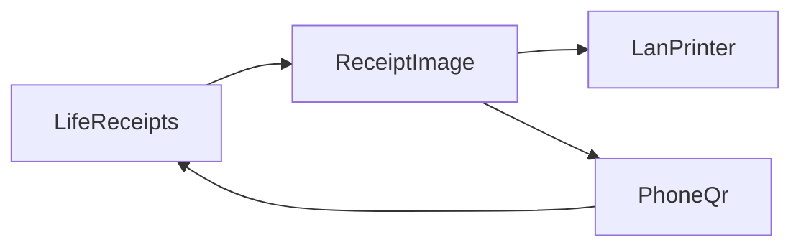

# Life receipts

A self-hosted morning slip. It gathers the day’s calendar, the weather, a few headlines, notes, and open to-dos, draws them as a receipt, and sends that image to a thermal printer on your network. New to-dos also print as their own tear-off cards.

The app has to run on a computer that can reach the printer. A cloud host cannot open a socket to a printer on your LAN. A Cloudflare Tunnel can publish this same local process at a hostname such as `https://receipts.ault.cc`. See [docs/hosting.md](docs/hosting.md).



## What you need

- Node.js 22 or newer
- A receipt printer that accepts raw ESC/POS on TCP, usually port 9100
- Optional: a Google Cloud OAuth client if you want the calendar section

Weather comes from [Open-Meteo](https://open-meteo.com/) and does not need a key. Headlines come from an RSS feed. Adding a city fills in a Google News search feed, which you can replace with any other feed.

## Run it

```bash
cp .env.example .env
npm install
npm run dev
```

Open http://localhost:3000. The first visit creates the owner account: a name, a username, a password, a timezone, and Fahrenheit or Celsius. That password stays in `data/` on this machine.

If this copy already had a single password, that password now signs in with the username `owner`. Rename it from Users.

The printer address is saved from the Printer page, not in git. Port 9100 is the usual raw port. Save the address, then use “Save and test print”. A short slip should come out. If the socket connects and the paper is blank or garbled, the printer is speaking a different raster dialect than ESC/POS `GS v 0`.

Morning print stays off until you turn on “Print every morning” and set a time. If the app is already running when that time passes, it prints once for that local date. A failed print is retried. Notes stay on the slip until a print succeeds. Approved to-do cards print after that slip.

## People

The owner manages places, the calendar, the printer, and the user list. From Users, the owner adds other people and either types a password or generates one. The password is shown once.

Those people can sign in only to add notes and to-dos. A to-do they add stays pending until the owner approves it. Pending items stay off the slip and off the tear-off cards.

The Notes page shows a private link, `/p/…`, to the owner. Anyone with the link can leave a note and see notes that are still waiting to print. The link can be replaced. The page allows five notes per ten minutes from one network.

## To-dos

The board has Pending, New, In progress, and Done. On a phone, one column shows at a time. Open a card to edit the title, the short description, the due date, and the notes on that card. The printed card shows the title, the short description, the due date, and a code on the right that opens that card.

## Google Calendar

1. In Google Cloud, create an OAuth client of type Web application.
2. Add the redirect URI: `APP_URL/api/calendar/callback`. For this network that is `http://localhost:3000/api/calendar/callback`, or `https://receipts.ault.cc/api/calendar/callback` once the tunnel is the public origin.
3. Put the client id and secret in `.env` as `GOOGLE_CLIENT_ID` and `GOOGLE_CLIENT_SECRET`.
4. Set `APP_URL` to the same origin you open in the browser.
5. Restart the app, open Calendar, and connect. The scope is calendar read-only.

Pick one calendar. The slip lists that calendar’s events for the local day. Tomorrow is a preview and does not print.

## Docker

The container must be able to route to the printer. On a Mac, `npm run dev` on the host is the reliable way to reach a printer such as `192.168.10.46`.

```bash
cp .env.example .env
docker compose up --build
```

Add the tunnel only when `TUNNEL_TOKEN` is set:

```bash
docker compose --profile tunnel up --build
```

The SQLite file is in `./data`, which is mounted into the container. The public hostname is chosen in the Cloudflare dashboard, not in this file. [docs/hosting.md](docs/hosting.md) uses `receipts.ault.cc` as the example.

## Environment

| Variable | Purpose |
| --- | --- |
| `APP_URL` | Public origin, used for the Google redirect and for codes on the slip |
| `GOOGLE_CLIENT_ID` | OAuth client id |
| `GOOGLE_CLIENT_SECRET` | OAuth client secret |
| `SESSION_SECRET` | Optional. If empty, the app writes `data/session-secret` |
| `TUNNEL_TOKEN` | Optional token for a remotely managed Cloudflare Tunnel |

## Develop

```bash
npm test
npm run build
```

How the pieces fit is in [docs/architecture.md](docs/architecture.md). Notes for agents working in this repo are in [AGENTS.md](AGENTS.md).

Fonts for the printed slip are Newsreader and IBM Plex Mono, both under the SIL Open Font License. Copies of the license are in `assets/fonts/`. Weather data is credited on the slip (Open-Meteo, CC BY 4.0).
