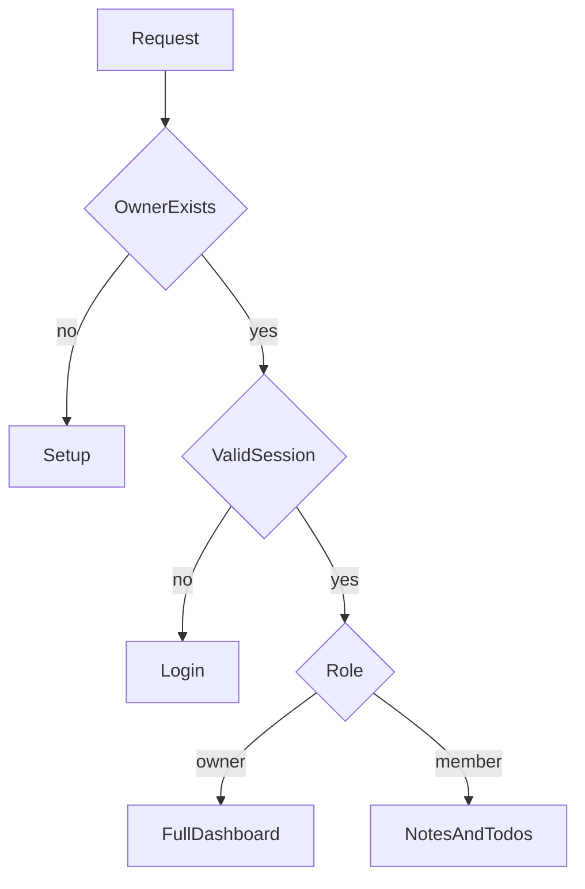
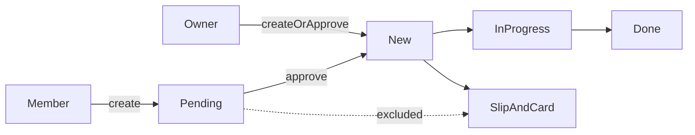
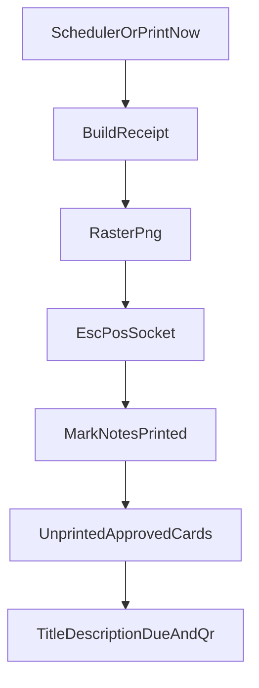

# Architecture

Life receipts runs as one Next.js process beside the printer. SQLite is the only database. The morning loop, the receipt image, and the ESC/POS socket all live in that process. A tunnel, when you add one, forwards HTTPS to this process. It does not move printing off the LAN.

## Sign-in

The owner is created at setup, or copied from the old single password as the username `owner`. Members are created by the owner. The session cookie stores the user id and the role.

Members who ask for another page are sent to `/todos`. Owner-only APIs return 403. A member can add a note, add a to-do, and comment on a to-do they are allowed to see. They can edit or remove a to-do only while it is still pending and they created it.

The unlisted `/p/[token]` page does not use an account. It accepts a few notes per address and shows notes that have not printed yet.

## To-dos

Pending items are not part of the morning slip and do not get a tear-off card. Approving a to-do sets it to new, which leaves `card_printed_at` empty so the next successful roundup prints the card. Printing a card at creation is owner-only and still refuses a pending item.

The board and `/todos/[id]` use the same card editor. The code on a tear-off card opens `/todos/[id]`. On a phone that path comes back through sign-in and returns to the card.

## Print pipeline

A scheduled or manual roundup builds one receipt, sends it, marks the captured notes printed, and records the job as successful. It then prints one ticket per approved to-do that has never had a card. A ticket failure is logged and, for a manual print, shown to the owner. It does not reopen the roundup job.

The ticket lays the title, short description, and due date on the left. The code sits on the right, with “Scan to update” under it. The roundup slip still lists open to-dos as a title and a due label, and its own code appears only when that list is not empty.

## Data

| Table | Holds |
| --- | --- |
| settings | Timezone, units, print time, printer, Google tokens, public note token |
| users | Name, username, password hash, role |
| places | Weather and headline sources |
| notes | Slip notes, pending until a successful print |
| todos | Title, short description, due date, status, who created it, when the card printed |
| todo_notes | Longer notes on a to-do card |
| print_jobs | One row per print attempt |

`lib/db.ts` applies this shape on startup, including columns added after the first run. The file is `data/roundup.sqlite`.

## Hosts

`APP_URL` is the origin people use. When it is not a loopback address, codes on the paper use it. A local `APP_URL` falls back to a private LAN address so a phone on the same network can open the card. `docs/hosting.md` is the tunnel setup. Cookies are marked Secure only when `APP_URL` starts with `https://`.
